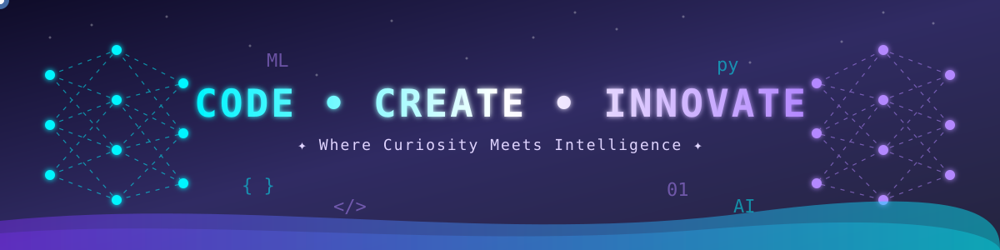

 

 

<b>💻 CSE Student • 🤖 AI & ML Enthusiast • 🚀 Developer</b>

 

  

 

 

 

 

  

 

### **“Learn. Code. Build. Repeat.”** 🚀

*Curiosity writes the first line, consistency builds the intelligence.* 🧠

 

 

 

 

  

&nbsp;

&nbsp;

&nbsp;

&nbsp;

&nbsp;

 

<table>
<tr>
<td align="center" width="170"><b>💻 Languages</b></td>
<td align="left">

</td>
</tr>
<tr>
<td align="center"><b>🗄️ Databases</b></td>
<td align="left">

</td>
</tr>
<tr>
<td align="center"><b>🤖 AI / ML</b></td>
<td align="left">

</td>
</tr>
<tr>
<td align="center"><b>🔧 Tools</b></td>
<td align="left">

</td>
</tr>
</table>

 

 

 

 

  

  

### ⭐ Thanks for stopping by! 🙏

